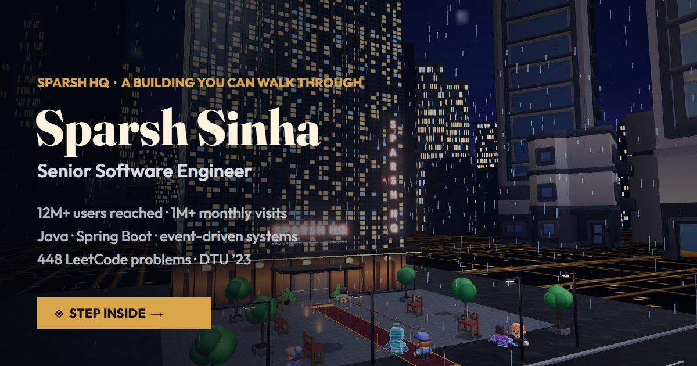

# SPARSH HQ

> *A building you can walk through. Every room ships software.*



The interactive portfolio of **Sparsh Sinha**, Senior Software Engineer. It's a real-time 3D building in the browser. You arrive on a rainy plaza at night, walk through the lobby, and take the elevator through eight themed floors. Every exhibit opens a compact case study. If you're short on time, one click (**Résumé**, or `R`) gives you the whole building as a single page.

No build step and no framework. It's plain ES modules plus vendored three.js r170 and GSAP.

## Run it locally

The site must be served over http (ES modules and glTF loading don't work from `file://`):

```bash
python -m http.server 8447
```

Then open <http://localhost:8447>. Add `#dev` to skip the intro. Add `#analytics_debug` to log every analytics event to the console.

Live at **https://benasus25.github.io/** (GitHub Pages).

## Controls

| Input | Action |
|---|---|
| click | walk there · click a gold ◆ **or the object itself** to open its story |
| `WASD` / arrows | walk (`Shift` to hurry) · `Q`/`←→` turn |
| drag / scroll | look around / zoom · `V` close-up |
| `E` | use whatever's nearby |
| `R` | the one-page résumé |
| `Tab` | show / hide the floor checklist (collapsed by default) |
| `F` | elevator · `C` NOVA (lobby) · `M` sound |
| touch (phones, tablets) | a thumbstick appears wherever your left thumb lands · drag the right half to look, pinch to zoom · tap anything to walk there or open it · the ◆ button (bottom-right) uses whatever's nearby · 💬 asks NOVA. Works upright or sideways; phones get a wider lens and lighter rendering. |

## The building

| Floor | Theme | What's there |
|---|---|---|
| Plaza | rain, red carpet | the tower, the street, the way in |
| F0 Reception | *The Continental* | **you meet Sparsh in person — then he folds into the glowing orb that guides you** · two big signposts: **Experience → F1**, **Education → F2** · NOVA, the directory totem, guest book |
| F1 Experience | *Avengers Tower* | **an enfilade: a foyer, then one room per job in a straight line through stone arches** — Xtreme (a ship's deck, sea charts, a route globe) → Pocketpills (bright pharmacy terrazzo, the floating capsule, **the six systems I built along one wall**) → Sprinklr (glass to the city, the CX core, **the stack I ship with**) · each room has the full detail wall, its numbers on plinths, and a "Chapter N" title as you step in · **a gallery along the south side reaches every room directly**, and the foyer board's "take me there" runs you straight to any chapter |
| F2 Education | *The Great Hall* | school at the entrance (CBSE XII, 90.4%) → **the degree year by year along a candlelit aisle (2019 → 2023)** → **the graduation stage: DTU, B.Tech Computer Engineering, 8.83 CGPA** · north: hall of achievements (448 LeetCode, CodeKaze 315, Hack with CW, IC²) · south: leadership (Sahitya, Enactus), core coursework, **the reading list** |
| F3 Projects | *Stark Labs* | **a round glass rotunda**: the energy core on a dais at the centre (and what it runs on), **sprHarness**, **Intra-Organisational Server**, **Voyage Optimiser** standing around it, a brass compass in the floor, the archive of **12 real GitHub repos** and the open-source bench on the south arc |
| F4 Penthouse | *Real Madrid suite* | what's next, the goals board, contact, a balcony in the rain |

Walk up to anything gold and a **caption** appears (title, one line, the numbers) while the orb tells you about it — no key press needed. `E` or a click opens the full case study. Every floor also has a collapsible **checklist** (top-left) of its exhibits.

## Editing content

All the words live in **`js/data/content.js`**: profile, labs, projects, repos, education, skills, case files, books, NOVA's brain and the ending. The downloadable résumé is `assets/Sparsh_Sinha_Resume.pdf` (set `links.resume` to `""` in `content.js` to hide the buttons). After editing any JS or CSS, bump the `?v=` numbers in `index.html` so browsers fetch the new files.

## Analytics

`js/engine/analytics.js` integrates Google Analytics 4 (and optionally Microsoft Clarity). It's **off until you paste a GA4 measurement id** into `CONTENT.analytics.ga4`, and it skips `localhost`. Each floor is a virtual page, and opens, résumé downloads, contact clicks, dwell time and frame rate are all events. Guest-book text, emails and chat messages are never sent to analytics.

## Guest book

Notes are delivered to `sparshsinha.spavis@gmail.com` through [FormSubmit](https://formsubmit.co). The first real submission sends an **activation email**, and you need to click it once. If the relay is unreachable, the form falls back to opening the visitor's mail app. Every note is also kept in the visitor's browser (localStorage).

## Architecture

```
index.html               import map + script order (bump ?v= to bust caches)
css/style.css            UI: HUD, cards, checklist, one-page résumé, splash, chat
js/boot.js               loads three.js r170 + addons (GLTFLoader, GTAO, bloom, SkeletonUtils…)
js/data/content.js       ALL words and numbers
js/engine/analytics.js   GA4 / Clarity wiring, floor page-views, event helpers
js/engine/look.js        procedural PBR textures (wood, marble, terrazzo, holograms, rain glass)
js/engine/kit.js         construction kit: walls (with camera-collision data), glass, doors, furniture, screens, info walls
js/engine/assets.js      Kenney glTF furniture + animated characters, NPC behaviours
js/engine/audio.js       procedural WebAudio: ambience per floor, rain, SFX
js/world/game.js         renderer + post (GTAO, bloom, grade), spring-arm camera, movement physics,
                         A* click-to-walk, occluder fading, interaction picking, cinematics
js/world/guide.js        the orb guide, the "meet Sparsh" intro, walk-up captions + narration
js/world/floors.js       plaza + reception, shared room helpers (shell, workstations, lounges)
js/world/floors2.js      Projects, Penthouse
js/world/floors3.js      set dressing (lobby totem, penthouse extras)
js/world/floors4.js      shared type + career-panel + stack-tile helpers, penthouse arrival
js/world/floors5.js      chapter centrepieces, the Education Great Hall, the lobby signposts
js/world/floors7.js      the Experience enfilade, the Projects rotunda, the Great Hall colonnade
js/ui/ui.js              prompts, elevator, books, guest book, NOVA, tutorial
js/ui/cards.js           case-study cards, floor checklists, the one-page résumé
js/main.js               splash → intro → tutorial
```

Under the hood:
- **Spring-arm camera** in 4.8 m rooms: high enough to show the whole character and most of the room, never outside the building or through a wall. It dips under a lintel to follow you through a doorway, cuts to a composed frame once you're through, and when a wall is close behind you it goes over-the-shoulder instead of looking down at your head.
- **Character animation.** Idle, walk and run are a blend tree driven by measured ground speed, with playback rate matched to the clips' stride (measured, not guessed) and walk/run kept in phase so blends don't scissor the legs. On top: gestures as layers, a procedural head-and-torso look-at (people look at whoever is talking or whatever you're reading), and a spring on the body that leans into starts, stops and turns. NPCs steer with a turn rate and ease in and out of stops; they step round to face you instead of spinning on the spot.
- **Staging.** You meet Sparsh with a walk-in, a cut to a two-shot, gestures and a nod back, then a squash-and-stretch transformation into the orb. You step out of the lift on every floor while the camera eases back from inside the car.
- **Performance governor.** Pixel budget per quality level, half-resolution AO and bloom, 2× MSAA, and a fixed pool of 8 point lights handed to the fixtures nearest the camera; resolution adapts live to keep ~60 fps.
- **Circle-vs-box movement.** You slide along walls and round corners. Click-to-walk uses A* with corner cutting and stuck detection.
- **Occluder fade.** Props that come between you and the lens turn translucent.
- **Rendering.** GTAO, selective bloom and a filmic grade.

## Credits

3D furniture, characters and city: [Kenney](https://kenney.nl) (CC0). Rendering: [three.js](https://threejs.org) (MIT). Animation: [GSAP](https://gsap.com) (free licence). Fonts: Outfit and Fraunces (Google Fonts, OFL).

The earlier isometric version is preserved in [`v1/`](v1/).

---

*Every room tells a story. Thanks for exploring mine.*
